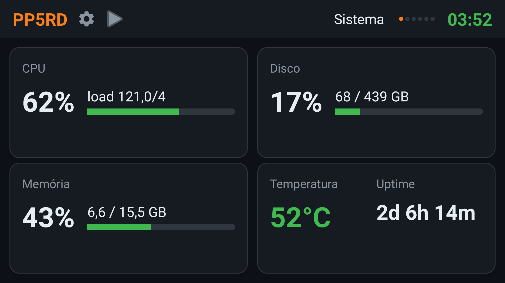
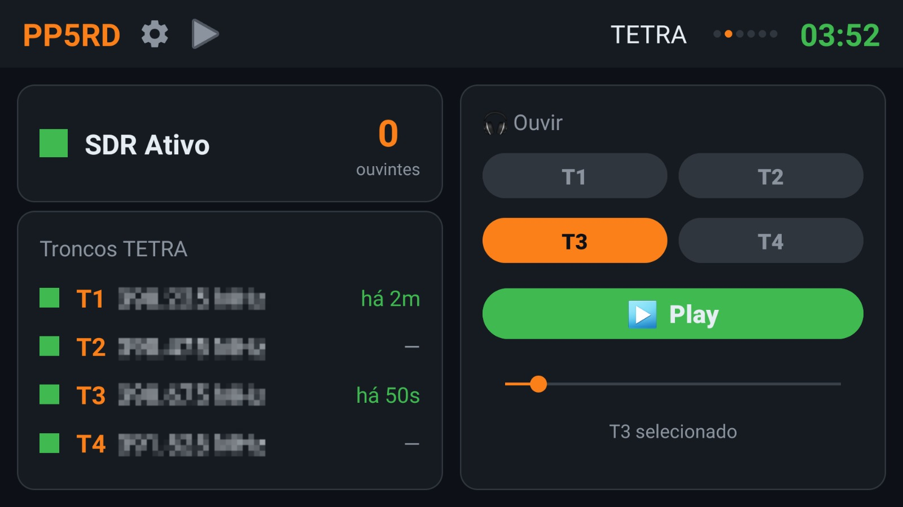
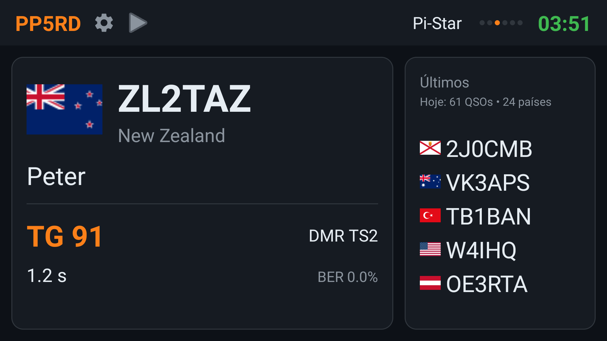
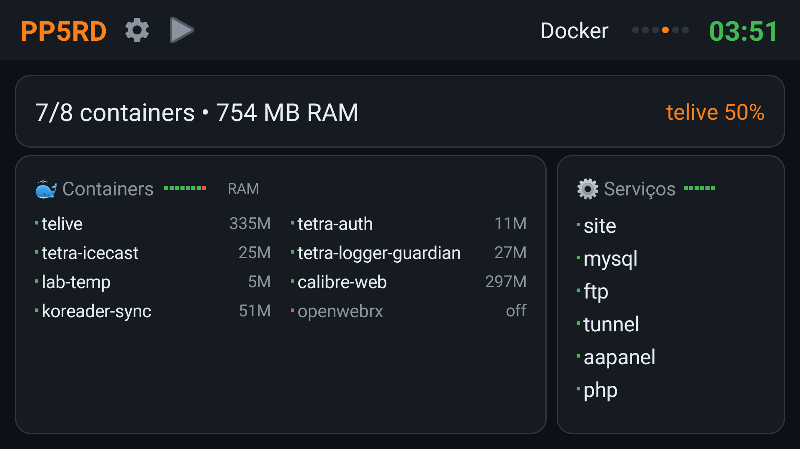
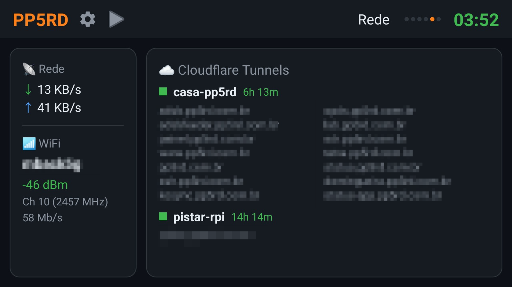
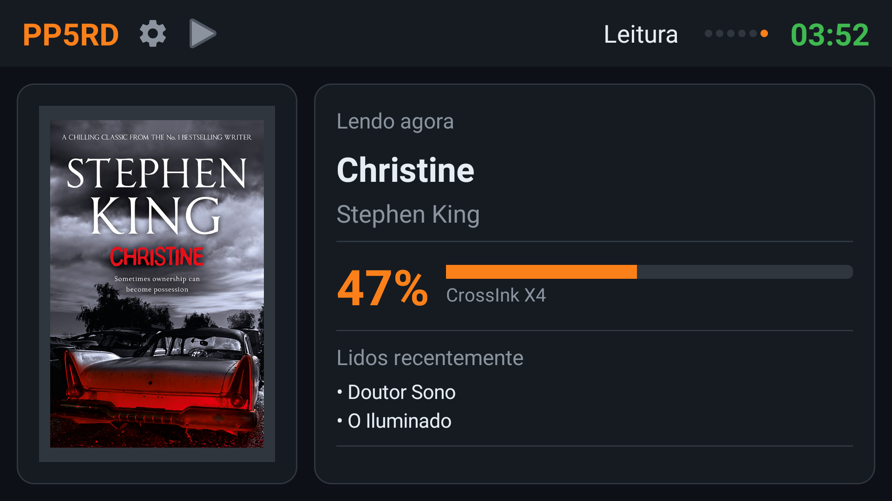

# pp5rd-status-app

*[Leia em Português](README.pt-BR.md)*

Desktop dashboard for monitoring a home server, built to run on a repurposed **Samsung J7 Prime 2** (Android 9).

## What is it

A native Android app that turns an old phone into an always-on status panel.

The idea came as an alternative to [pistar-cyd-panel](https://github.com/danielregis81/pistar-cyd-panel), a "who's talking" panel for Pi-Star that I made for ESP32 CYD (Cheap Yellow Display). My hotspot only has a tiny 0.96" OLED screen, so an external panel shows much more information. An old phone sitting in a drawer can be a cheaper option with a larger/better screen than buying a CYD.

What was supposed to be a simple Android version of that panel ended up becoming a complete server monitor, with 6 screens showing system, SDR listening stream (TETRA), Pi-Star, Docker, network and reading.

## Screens

The app has 6 screens, navigated by swipe (slide left/right):

### 1. System
Server metrics: CPU usage, RAM, disk, processor temperature and uptime.

### 2. TETRA
The server has an RTL-SDR dongle that decodes digital transmissions in the TETRA standard (unencrypted) on 4 frequencies simultaneously. The screen shows:
- SDR status and 4 trunks with call counter
- Live audio player with trunk selection (T1-T4)
- Volume control

### 3. Pi-Star
DMR hotspot (Pi-Star) information, read directly from the Pi-Star's `/cyd/status.json` endpoint (the same that feeds the [pistar-cyd-panel](https://github.com/danielregis81/pistar-cyd-panel)):
- Current station: flag, callsign, name, country, talkgroup, mode/slot
- "ON AIR" badge when someone is transmitting
- Last heard list with flags
- Daily statistics (stations and countries)

### 4. Docker
Container list with status (running/stopped).

### 5. Network
- Network traffic (download/upload)
- Active connections
- Cloudflare tunnel status

### 6. Reading
Integration with KOReader and self-hosted kosync server. KOReader is an ebook reading app that runs on CrossInk e-readers (e-ink) and also on phones. Kosync syncs reading position between devices - so I can continue reading on my phone where I left off on the e-reader and vice versa.

The screen shows:
- Currently reading book (cover, title, author, progress)
- Which device was used last (CrossInk X4, phone, etc)
- Recently read books

## Why a native app?

- **Performance**: old phones are slow; a WebView was laggy, but native Kotlin runs smooth
- **Always-on screen**: fullscreen without browser, no bars, no distractions
- **TETRA audio**: streaming via ExoPlayer with authentication, volume control and trunk selection
- **Swipe to navigate**: simple gesture to switch screens, no on-screen buttons

## Connection mode

The app supports two modes (configurable in Settings via gear icon):

- **Local**: HTTP endpoint on internal network (no authentication)
- **External**: HTTPS endpoint via Cloudflare tunnel with Service Token

### Why the Service Token?

The Cloudflare tunnel that exposes the server data (`/stats`) is protected by **Cloudflare Access** - an authentication layer that prevents unauthorized access. Without this protection, anyone who discovered the URL could see sensitive data (CPU, memory, containers, IPs, etc).

The Service Token is a credential that allows the app to authenticate automatically, without requiring login. The `CF-Access-Client-Id` and `CF-Access-Client-Secret` headers are sent with each request to the server.

The Pi-Star endpoint (`/cyd/status.json`) uses a separate tunnel that runs on the Pi-Star itself (the DMR hotspot's Raspberry Pi), not on the main server. This tunnel has no Cloudflare Access protection, so it doesn't need a token.

## Screenshots

<table>
<tr>
<td align="center"><b>System</b><br></td>
<td align="center"><b>TETRA</b><br></td>
<td align="center"><b>Pi-Star</b><br></td>
</tr>
<tr>
<td align="center"><b>Docker</b><br></td>
<td align="center"><b>Network</b><br></td>
<td align="center"><b>Reading</b><br></td>
</tr>
</table>

## Build

```bash
# 1. Copy the token file (required)
cp app/src/main/java/com/pp5rd/status/ServiceToken.kt.example \
   app/src/main/java/com/pp5rd/status/ServiceToken.kt

# 2. (Optional) Edit ServiceToken.kt with your Cloudflare Access token

# 3. Copy and edit the local config (addresses and TETRA frequencies)
cp app/src/main/java/com/pp5rd/status/LocalConfig.kt.example \
   app/src/main/java/com/pp5rd/status/LocalConfig.kt

# 4. Build
export JAVA_HOME=/usr/lib/jvm/java-17-openjdk-amd64
export ANDROID_HOME=~/android-sdk
./gradlew assembleDebug
# APK at app/build/outputs/apk/debug/app-debug.apk
```

> **Important**: `ServiceToken.kt` and `LocalConfig.kt` are in `.gitignore` and must never be committed.

## Structure

```
app/src/main/
├── java/com/pp5rd/status/
│   ├── MainActivity.kt      # Screens, swipe, ExoPlayer
│   ├── ApiClient.kt         # OkHttp with Service Token interceptor
│   ├── Models.kt            # JSON data classes
│   └── SettingsActivity.kt  # Preferences (local/external)
└── res/
    ├── layout/              # Screen XMLs
    ├── drawable/            # Icons
    └── values/              # Colors, strings
```

## Adapting for your use

This is a personal project. The code is public as a reference for anyone who wants to do something similar, but it's not a generic app - it depends on a specific backend (collector script) and services running on the server.

To adapt:
1. Create a script that generates a JSON with your server metrics
2. Serve this JSON via HTTP (nginx, Python, etc.)
3. Modify `ApiClient.kt` with your endpoints
4. Adjust `Models.kt` for your JSON format
5. Adapt the screens in `MainActivity.kt`

## License

MIT
