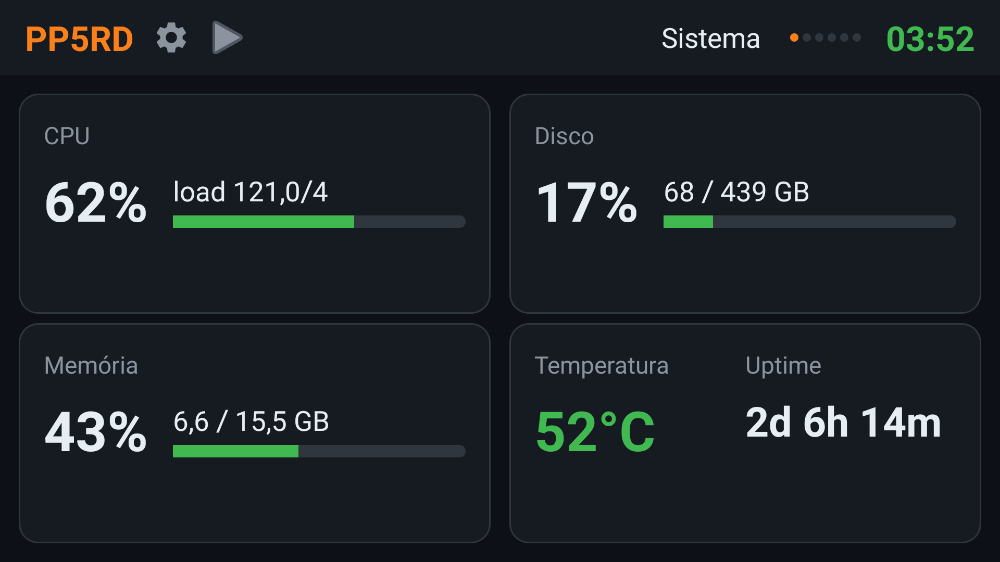
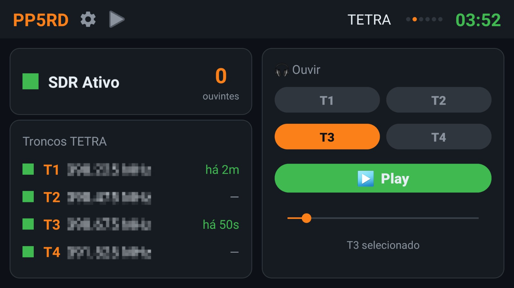
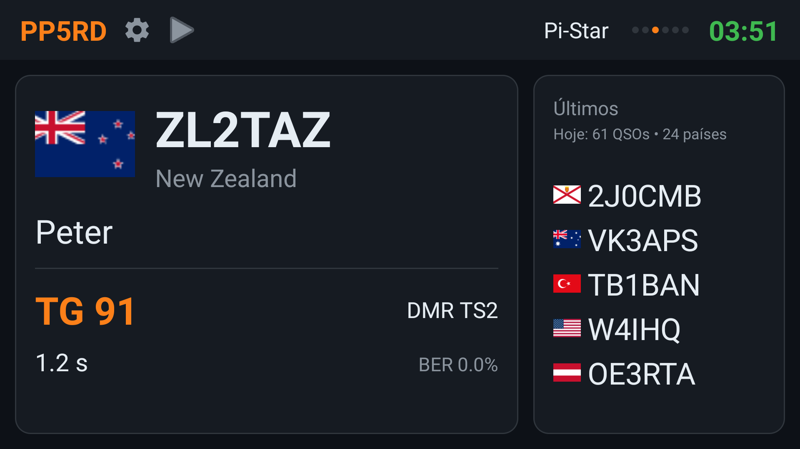
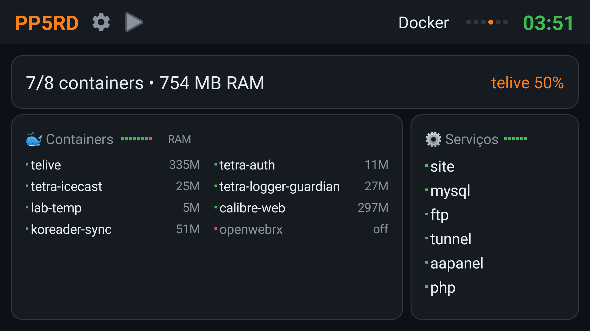
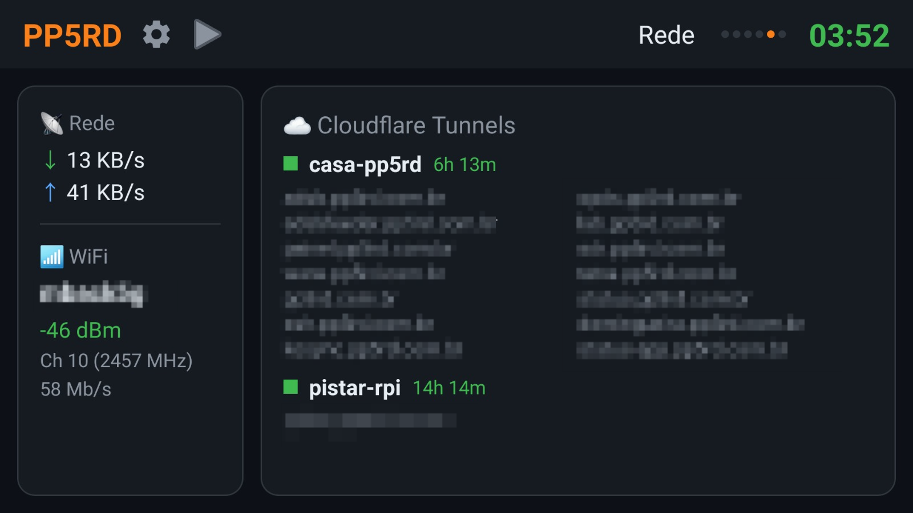
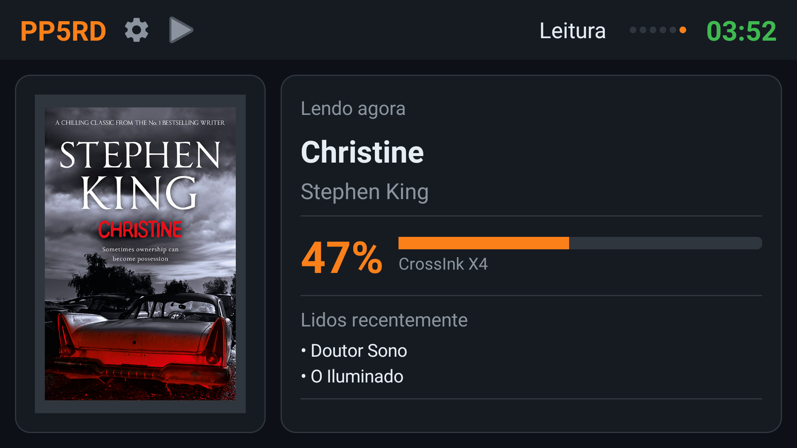

# pp5rd-status-app

*[Read in English](README.md)*

Dashboard de mesa para monitorar servidor doméstico, feito para rodar em um **Samsung J7 Prime 2** (Android 9) reaproveitado.

## O que é

Um app Android nativo que transforma um celular antigo em um painel de status sempre ligado. 

A ideia surgiu como alternativa ao [pistar-cyd-panel](https://github.com/danielregis81/pistar-cyd-panel), um painel "quem está falando" para Pi-Star que fiz para ESP32 CYD (Cheap Yellow Display). Meu hotspot tem apenas uma telinha OLED de 0.96", então o painel externo mostra muito mais informação. Um celular antigo esquecido na gaveta pode ser uma opção mais barata e com tela maior/melhor do que comprar um CYD.

O que era pra ser uma simples versão Android daquele painel acabou virando um monitor completo do servidor, com 6 telas mostrando sistema, streaming de escuta com dongle SDR (TETRA), Pi-Star, Docker, rede e leitura.

## Telas

O app tem 6 telas, navegadas por swipe (deslizar para os lados):

### 1. Sistema
Métricas do servidor: uso de CPU, memória RAM, disco, temperatura do processador e uptime.

### 2. TETRA
O servidor tem um dongle RTL-SDR que decodifica transmissões digitais no padrão TETRA (não criptografadas) em 4 frequências simultaneamente. A tela mostra:
- Status do SDR e dos 4 troncos com contador de chamadas
- Player de áudio ao vivo com seleção de tronco (T1-T4)
- Controle de volume

### 3. Pi-Star
Informações do hotspot DMR (Pi-Star), lidas diretamente do endpoint `/cyd/status.json` do Pi-Star (o mesmo que alimenta o [pistar-cyd-panel](https://github.com/danielregis81/pistar-cyd-panel)):
- Estação atual: bandeira, indicativo, nome, país, talkgroup, modo/slot
- Badge "NO AR" quando alguém está transmitindo
- Lista dos últimos ouvidos com bandeiras
- Estatísticas do dia (estações e países)

### 4. Docker
Lista de containers com status (rodando/parado).

### 5. Rede
- Tráfego de rede (download/upload)
- Conexões ativas
- Status dos túneis Cloudflare

### 6. Leitura
Integração com KOReader e servidor kosync próprio. O KOReader é um app de leitura de ebooks que roda nos e-readers CrossInk (e-ink) e também no celular. O kosync sincroniza a posição de leitura entre dispositivos - assim posso continuar lendo no celular de onde parei no e-reader e vice-versa.

A tela mostra:
- Livro sendo lido atualmente (capa, título, autor, progresso)
- Qual dispositivo foi usado por último (CrossInk X4, celular, etc)
- Últimos livros lidos

## Por que um app nativo?

- **Performance**: celulares antigos são lentos; um WebView travava, mas Kotlin nativo roda suave
- **Tela sempre ligada**: fullscreen sem navegador, sem barras, sem distrações
- **Áudio TETRA**: streaming via ExoPlayer com autenticação, controle de volume e seleção de tronco
- **Swipe para navegar**: gesto simples para trocar de tela, sem botões na tela

## Modo de conexão

O app suporta dois modos (configurável nas Settings via ícone de engrenagem):

- **Local**: endpoint HTTP na rede interna (sem autenticação)
- **Externo**: endpoint HTTPS via túnel Cloudflare com Service Token

### Por que o Service Token?

O túnel Cloudflare que expõe os dados do servidor (`/stats`) está protegido pelo **Cloudflare Access** - uma camada de autenticação que impede acesso não autorizado. Sem essa proteção, qualquer pessoa que descobrisse a URL poderia ver dados sensíveis (CPU, memória, containers, IPs, etc).

O Service Token é uma credencial que permite o app se autenticar automaticamente, sem precisar de login. Os headers `CF-Access-Client-Id` e `CF-Access-Client-Secret` são enviados em cada requisição ao servidor.

O endpoint do Pi-Star (`/cyd/status.json`) usa um túnel separado que roda no próprio Pi-Star (Raspberry Pi do hotspot DMR), não no servidor principal. Esse túnel não tem proteção do Cloudflare Access, por isso não precisa de token.

## Screenshots

<table>
<tr>
<td align="center"><b>Sistema</b><br></td>
<td align="center"><b>TETRA</b><br></td>
<td align="center"><b>Pi-Star</b><br></td>
</tr>
<tr>
<td align="center"><b>Docker</b><br></td>
<td align="center"><b>Rede</b><br></td>
<td align="center"><b>Leitura</b><br></td>
</tr>
</table>

## Build

```bash
# 1. Copiar o arquivo de token (obrigatório)
cp app/src/main/java/com/pp5rd/status/ServiceToken.kt.example \
   app/src/main/java/com/pp5rd/status/ServiceToken.kt

# 2. (Opcional) Editar ServiceToken.kt com seu token do Cloudflare Access

# 3. Copiar e editar a configuração local (endereços e frequências TETRA)
cp app/src/main/java/com/pp5rd/status/LocalConfig.kt.example \
   app/src/main/java/com/pp5rd/status/LocalConfig.kt

# 4. Compilar
export JAVA_HOME=/usr/lib/jvm/java-17-openjdk-amd64
export ANDROID_HOME=~/android-sdk
./gradlew assembleDebug
# APK em app/build/outputs/apk/debug/app-debug.apk
```

> **Importante**: Os arquivos `ServiceToken.kt` e `LocalConfig.kt` estão no `.gitignore` e nunca devem ser commitados.

## Estrutura

```
app/src/main/
├── java/com/pp5rd/status/
│   ├── MainActivity.kt      # Telas, swipe, ExoPlayer
│   ├── ApiClient.kt         # OkHttp com interceptor de Service Token
│   ├── Models.kt            # Data classes do JSON
│   └── SettingsActivity.kt  # Preferências (local/externo)
└── res/
    ├── layout/              # XMLs das telas
    ├── drawable/            # Ícones
    └── values/              # Cores, strings
```

## Adaptando para seu uso

Este é um projeto pessoal. O código está público como referência para quem quiser fazer algo parecido, mas não é um app genérico - ele depende de um backend específico (script coletor) e dos serviços rodando no servidor.

Para adaptar:
1. Crie um script que gere um JSON com as métricas do seu servidor
2. Sirva esse JSON via HTTP (nginx, Python, etc.)
3. Modifique `ApiClient.kt` com seus endpoints
4. Ajuste `Models.kt` para o formato do seu JSON
5. Adapte as telas em `MainActivity.kt`

## Licença

MIT
